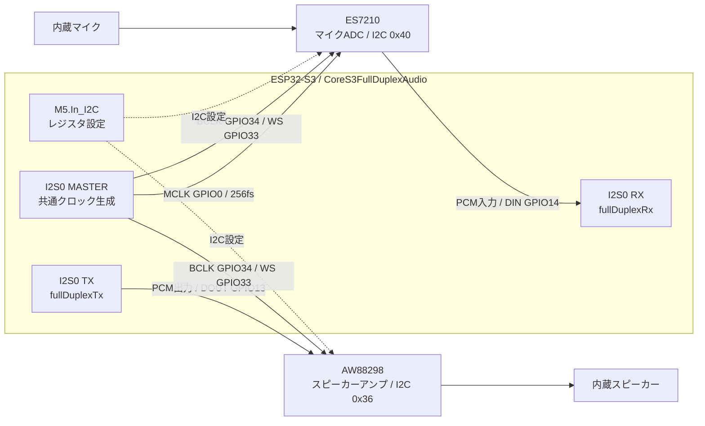

# FW Design Information
Notes on FW design, etc.

- [Task](#task)
- [Mod](#mod)
  - [ESP-NOW Remote Control Mod](#esp-now-remote-control-mod)
  - [GPTLive Full Duplex](#gptlive-full-duplex)
- [Function Calling](#function-calling)
  - [Avatar Expression](#avatar-expression)
- [Wi-Fi config portal](#wi-fi-config-portal)
- [Web App](#web-app)
  - [Home page](#home-page)
  - [Config page](#config-page)
  - [Personalize page](#personalize-page)
- [Status Monitor](#status-monitor)
- [Head Touch Sensor](#head-touch-sensor)

## Task

| Task name | function | Stack size [bytes] | Priority |
| --- | --- | --- | --- |
| loopTask | Arduino loop task | 8192 | 1 |
| drawLoop | Avatar control | 4 * 1024 | 2 |
| facialLoop | Avatar control | 1024 | 2 |
| lipSync | Lip Sync for avatar| 2048 | 2 |
| servo | Servo control synchronized with the avatar | 2048 | 1 |
| battery_check | Battery level check | 2048 | 1 |
| asyncTtsStreamTask | TTS streaming play | 5 * 1024 | 2 |
| webSocketLoopTask | WebSocket processing for LLM Realtime API | 6 * 1024 | 3 |
| fullDuplexRx | CoreS3 experimental direct I2S RX | 4096 | 3 |
| fullDuplexTx | CoreS3 experimental direct I2S TX | 4096 | 3 |
| SanoTTS | SanoTTS parsing, inference, and playback | 16 * 1024 | 2 |

SanoTTS は同期 `stream()` の要求を専用ワーカーで直列処理する。CoreS3 の SanoTTS 環境では `SANOTTS_BUFFERED_PLAYBACK` により、句読点などで分割した各区間の PCM を PSRAM に全量確保・合成してから再生する。M5Unified が現在区間を再生している間に同じワーカーが次区間を合成し、2個のPCMバッファを交互に再利用する。1区間は最大30秒で約1.26 MiB、先行生成時は最大約2.52 MiBのPCMに加え、176 KiBの解析・推論 arenaを使う。次区間用バッファを確保できない場合は現在区間の再生後に直列生成で再試行する。リップシンク用レベルはPCMから作った音量エンベロープを再生時刻で参照する。フラグを外すと先読みと循環バッファによる逐次再生になる。いずれも再生終了後にマイクとスピーカーの元の状態を復元する。切り替え方法は[doc/sanotts.md](sanotts.md) を参照。

GPTLive の音声出力は追加タスクを作らず、既存の webSocketLoopTask で受信・蓄積・再生要求を処理する。音声 mutex は同じタスクが取得・解放し、再生中は保持する。モード停止要求は atomic フラグで通知し、同タスクが音声の後始末を完了したことを通知してから suspend する。

## Mod
### ESP-NOW Remote Control Mod

初期実装では `src/mod/EspNowRemote` に Receiver 固定の Mod を追加する。

- Wi-Fi channel は `1` 固定。
- ESP-NOW 受信コールバックでは payload を固定バッファへコピーするだけにし、Serial 出力は Mod の `idle()` で行う。
- 標準 firmware の Sender から受けた場合は Arduino `esp_now` の受信 data でアプリ payload が offset `20` から始まるため、offset `20` を優先して標準 8 byte 形式として decode 表示する。8 byte だけ届く場合は offset `0` から decode する。
- ESP-NOW Remote Mod 実行中は `main.cpp` の Avatar gaze 連動 servo task を抑止し、受信した yaw/pitch を `ServoCustom::moveTo()` に渡す。
- yaw `-1280..1280` は servo x `45..-45` 度へ、pitch `0..900` は servo y `0..-30` 度へ変換する。
- payload の speed は `ServoCustom::moveTo()` の移動時間 ms として渡す。
- laser にはまだ反映しない。
- ESP-NOW Mod 実行中は Wi-Fi channel 変更により Web/FTP/Realtime API と干渉する可能性がある。
- ESP-NOW Mod 離脱時は ESP-NOW を停止し、offline mode でなければ Wi-Fi STA の再接続を最大 5 秒待つ。

### GPTLive Full Duplex

m5stack-cores3-realtime の GPTLIVE_FULL_DUPLEX フラグが有効な場合、OpenAI選択時に GPTLive を生成する。その他の通常Realtime環境はRealtimeChatGPTを使う。接続・セッション管理・音声送受信をGPTLiveに集約し、RealtimeLLMBaseを直接継承する。GPTLiveの宣言・実装はGPTLIVE_FULL_DUPLEX有効時に限定し、既存のCoreS3・非TTS制約を維持する。

GPT-Liveの音声経路では接続状態とセッション状態を分ける。CONNECTEDでは接続済み待機（Please touch）となり、タッチによる要求をWebSocketタスクが受けてsession.startを一度送る（Starting...）。storeはfalseを明示し、session.started後にだけ音声を送信する（Listening...）。開始待ち・終了待ちの重複タッチは無視し、通信断やモード復帰で課金セッションを自動開始しない。

停止要求では入力と再生を停止・破棄し、session.closeを送ってイベント受信を続ける（Stopping...）。session.closedの最終usage.seconds、終了理由、セッションIDをログに残して切断する。利用量の更新は累積値の上書きとし加算しない。開始待ちと終了待ちは各15秒で打ち切り、終了イベント前の切断・タイムアウトは最終利用量未確定として扱う。モード停止でもWebSocketタスクが終了待ちを処理してから休止する。明示停止は委譲中処理の完了を待たず、session.closeにより待機中のバックエンド処理が中断される場合がある。次回は新しい接続・セッションを作り、forkや新たな履歴引き継ぎは行わない。実装・確認記録は[ステアリング](codex/steering/20261021-gptlive-session-lifecycle.md)を参照する。

無会話タイムアウトは60000 ms固定とし、session.startedで最終会話時刻を初期化する。Activeかつ録音要求が有効な間、session.input_transcript.delta／session.output_transcript.deltaの前後空白を除いたテキストが空でなければ、WebSocketタスクが受信時のmillis()で時刻を更新する。符号なし差分で経過を判定し、60秒更新がなければ録音要求を解除して既存の正常終了経路へ進む。音声delta・利用量更新・ツール処理では延長せず、処理中も適用する。終了後は再タッチを必要とする。文字起こしの遅延・欠落・誤認識やAIの自発発話に影響されるため、厳密な無音検出や60秒ちょうどの課金終了は保証しない。

#### M5Unifiedの音声APIだけでは同時使用できない理由

CoreS3の内蔵マイクはES7210（ADC）、スピーカーはAW88298（デジタル入力アンプ）を通してESP32-S3に接続される。録音データと再生データの線は独立しているが、BCLKとWS（LRCK）は両ICで共有する。このため、録音と再生を同時に行うには、共通のクロックとフレーム形式でTX／RXを動作させる必要がある。

本プロジェクトで使用するM5Unified 0.2.15のCoreS3標準設定は、`M5.Mic`と`M5.Speaker`の両方にI2S1を割り当てる。一方、Arduino-ESP32 2.0.9で使う旧I2S APIの経路では、`Mic_Class`は`MASTER | RX`、`Speaker_Class`は`MASTER | TX`として個別にドライバをインストールする。インストールに失敗すると既存ドライバをアンインストールして再試行し、それぞれの終了処理もポートを解放する。したがって、`M5.Mic.begin()`と`M5.Speaker.begin()`を両方呼んでも、先に開始した方向を維持したままTX／RXを共有する構成にはならない。

また、別々のI2Sポートへ割り当てるだけでは、同じBCLK／WS配線を二つの独立したマスターで駆動する問題が残る。ここでの制約は、CoreS3の共有配線と、このバージョンのMic／Speakerがポートを個別管理する方式の組合せにある。音声ICやESP32-S3自体が全二重に対応できないという意味ではない。

#### 共有クロックによる全二重I2Sへの切り替え

音声入出力を[CoreS3FullDuplexAudio](../src/driver/CoreS3FullDuplexAudio.cpp)に集約し、ESP-IDFの`driver/i2s.h`を直接使ってI2S0を`I2S_MODE_MASTER | I2S_MODE_TX | I2S_MODE_RX`で一度だけ初期化する。I2S0への変更はESP32-S3内部のポート選択であり、CoreS3基板の配線変更は不要。同じポートが作るBCLK／WSに同期して、独立したデータ線で録音と再生を同時に進める。

GPIOのDIN／DOUTと入出力方向はESP32-S3基準。図のBCLK／WSは同じ共有信号を二つのICへ分配している。MCLKはES7210へ供給し、AW88298へのMCLK接続は使わない。実線は音声データ／クロック、破線は設定経路を表し、I2CにはPCMを流さない。

切り替えは次の順序で行う。

1. WebSocketタスクが音声mutexを取得し、元のMic／Speakerの稼働状態を記録して`M5.Mic.end()`／`M5.Speaker.end()`で既存の音声処理を終了する。
2. `initCodecs()`が`M5.In_I2C`経由でES7210／AW88298を直接設定する。レジスタ列はM5Unifiedを基にし、AW88298のレジスタ`0x06`は`0x14C5`として24 kHz、16 bit、左スロット、BCLK 32fsに合わせる。アンプの有効化にはAW9523の制御も使う。
3. I2S0を24 kHz／16 bit／左モノラルスロット、MCLK 256fsで開始する。専用RX／TXタスクが同じポートを`i2s_read()`／`i2s_write()`し、応答再生中も録音を継続する。出力PCMがない期間もTXはゼロを送り、クロックとRXを維持する。
4. 終了時はRX／TXタスクの終了を待ち、直接I2Sと音声ICを停止・解放する。キュー／PSRAMを解放してから元の稼働状態に応じてM5音声を再開し、音声mutexを解放する。

この間は`M5.Mic`／`M5.Speaker`からの再初期化や他の音声再生を抑止する。画面・電源・I2Cには引き続きM5Unifiedを使い、音声のポート管理だけを直接I2Sへ移す。これによりI2Sでの同時録音・再生を実現するが、スピーカー音がマイクへ回り込む音響エコーは別の問題であり、AECは未実装。

照合元はM5Unified 0.2.15の`M5Unified.cpp`（CoreS3のピン／ポートと音声IC設定）、`utility/Mic_Class.cpp`／`utility/Speaker_Class.cpp`（各方向のI2S管理）、および現行の`CoreS3FullDuplexAudio::begin()`／`initCodecs()`／`end()`。利用・確認手順は[GPTLive全二重通信](gptlive_full_duplex.md)を参照する。

#### バッファ・タスクと競合制御

- WebSocketタスクが音声mutexを待たずに取得し、既存M5音声を終了して直接I2Sを開始する。同じタスクが終了・復元・mutex解放まで担当する。実験ビルドの効果音／アラーム音はmutexを取得できなければスキップし、UIタスクを所有権待ちで止めない。WakeWordはビルドフラグで無効、非TTS構成なので非同期TTSは起動しない。別TTSのRobot::speechも実験フラグ内で無効化し、/speechは503を返す。
- fullDuplexRxは20 ms（480 sample）ずつ継続収集し、世代番号付き8窓のFreeRTOSキューへ渡す。WebSocketタスクだけがloop／sendを行い、1回最大2窓を送信する。入力キュー満杯時は新着窓を破棄し、RXdropへ計上する。I2Sの部分readは同じ窓へ蓄積する。停止中・古い世代の窓は送信しない。
- 受信PCMは100 KiBのPSRAM作業領域でデコードし、512 KiBのPSRAMリングへ全チャンクの空きを確認して追加する。fullDuplexTxは20 msずつ専用タスクの作業領域へコピーしてからリングを解放し、部分writeを完了まで進める。データがなければゼロを送ってクロックとRXを維持する。DMA領域はI2Sドライバの内部DMAメモリを使う（6 descriptor、480 sample）。
- リングだけを専用mutexで短時間保護し、WebSocket待ち・I2S待ち中には保持しない。動作／失敗／録音許可／世代／音量／レベル／カウンタはatomic。RX/TXそれぞれ4096 byteのタスクスタックを使う。音量はPCMへ0〜255の二乗比で適用し、DMAへ送る窓の出力レベルをリップシンクへ返す（実再生とはDMAの待ち時間分ずれる）。
- PCM出力の無音判定でマイクを止めず、出力中も実マイクを送信する。30秒の自動録音タイムアウトは適用せず、手動停止まで継続する。AECと送信マスクは未実装で、回り込みによる自己応答は未解決の評価項目。
- 手動停止／モード停止／切断／不正PCM／リング満杯／I2S障害では協調停止する。50 ms上限のI/O待ちからRX/TXが戻るのを待ち、I2S・音声ICを停止し、キュー／PSRAMを解放してから従来M5音声を復元し、mutexを解放する。I/Oが500 ms進行しなければ失敗にする。再開時はI2Sを新規に作り、旧PCMを持ち越さない。タスク生成途中の失敗も同じ後始末で扱う。
- RX／TX／Sent、キュー破棄数、TX無音窓数、入力／出力ピークを約2秒ごとに記録する。TXカウンタはゼロ送信も含むため、応答出力の確認にはoutLevelも使う。

任意の GPTLIVE_FULL_DUPLEX_TEST_TONE フラグでは、タッチで100 msのテスト音と連続RXを動かす単独診断モードとなり、WebSocket処理・API送信は行わない。通常ビルドでも診断コードの型・構文をコンパイルし、無効時は実行しない。

## Function Calling

### GPT-Live

GPTLIVE_FULL_DUPLEX構成では、組み込み関数と有効・接続済みMCPクライアントのツールを`session.delegation.responses.tools`へResponses形式で登録する。web_searchは維持し、関数の実行には既存のFunctionCallを使う。音声モデルには委譲条件を、バックエンドにはロール・メモリ情報・関数利用方針を渡す。`parallel_tool_calls=false`でローカル実行を直列化する。音声入力を再取得するask／WakeWord関連関数は登録しない。名前の衝突・定義の不整合・初期化失敗時はセッションを開始しない。

WebSocketタスクが`response.event`内の`response.output_item.done`を処理し、function_callのcall_id・name・argumentsをコピーする。専用のgptLiveToolsタスク（優先度1、スタック8192 bytes）が実行し、WebSocketタスクが`response.item.create`で結果を返す。バックエンドresponseの完了と全関数結果の返却を待って`response.create`を一度送る。WebSocketへのアクセスは既存タスクだけが担当し、音声ドライバーの資源所有は変えない。

要求キューは2件、結果キューは4件で、キューはPSRAM上の要求・結果領域へのポインターを受け渡す。関数名・call_idは各127 bytes、引数JSONは4095 bytes、結果は8191 bytesまで。登録済みスキーマの必須引数・型・enumとタイマーの範囲を検証する。未知の関数、不正引数、要求キュー満杯、結果の上限超過にはエラー結果を返す。関数定義全体は24 KiB、session.startは60 KiBの送信サイズを上限とする。

セッション内で最大128件のcall_idと128件のバックエンドresponseを保持し、重複call_idを再実行しない。追跡上限に達した場合は履歴を捨てて再実行を許すことなくセッションを終了する。停止・切断時は世代を更新して未着手要求を破棄し、実行中の結果を新セッションへ返さない。実行開始済みの操作の副作用は取り消さず、自動再試行もしない。新セッション開始とモード休止完了は実行中要求の終了を待つため、外部通信の所要時間に依存する。ワーカーとMCPクライアントはLLMインスタンス・既存WebSocketタスクと同じ存続期間を持つ。

GPT-Live用MCPクライアントには30秒の応答待ちタイムアウトを設定する。接続・HTTP処理のブロック時間は別途加わる。タイムアウトは実行結果未確定として返し、自動再実行しない。他サービスのクライアントは省略引数0で従来の待機動作を維持する。

### Avatar Expression

Realtime API ビルドでは、Function Calling により AI が会話中の感情に合わせて Avatar の表情を変更できる。

- 対象ビルド
  - `REALTIME_API` が定義される PlatformIO 環境。
- 関数名
  - `set_avatar_expression`
- 引数
  - `expression`: `neutral`, `happy`, `angry`, `sad`, `doubt`, `sleepy`
- 実装
  - `src/llm/ChatGPT/FunctionCall.cpp`
  - `m5avatar::Expression` に変換して `Avatar::setExpression()` を呼び出す。
  - `LLMBase.cpp` の `systemRole_realtimeAvatarExpression` で Realtime API の system instructions に利用方針を明示する。
- スコープ
  - `json_Functions` は通常 ChatGPT や Gemini Live からも参照されるため、この関数の schema と実行処理は `#if defined(REALTIME_API)` で限定する。
  - `systemRole_realtimeAvatarExpression` は Realtime 系 LLM の `load_role()` で `systemRole_memory` または `systemRole_noMemory` に追加する。

## Wi-Fi config portal

SmartConfig は使わず、起動時の Wi-Fi 接続元は YAML の `wifi.ssid` / `wifi.password` のみにする。

- SD に設定 YAML がある場合は SD を優先する。
- SD が無い、または主要 YAML が無い場合は SPIFFS の YAML を使う。
- `SC_ExConfig.yaml`、`SC_SecConfig.yaml`、`SC_BasicConfig.yaml` の一式が揃っていない場合は通常機能を起動しない。
  - `REALTIME_API` ビルドでは、`SC_SecConfig.yaml` がある場合は Wi-Fi 接続だけ試し、成功したら STA 接続上で設定 Web を起動する。
  - `REALTIME_API` ビルドでは、Wi-Fi 接続できない場合、または `SC_SecConfig.yaml` も無い場合は Config AP を起動する。
  - `REALTIME_API` 以外のビルドでは、不完全な設定を画面に表示し、そのまま待機する。
- 設定一式が揃っている通常起動時は、`wifi.ssid` が空、または接続に失敗した場合に画面上で Config AP 起動または Offline 起動を選ぶ。
- Config AP は SSID `StackChanEx-Config-NNNNNN`、password `stackchan` で起動し、`http://192.168.4.1/` の QR コードを画面に表示する。SSID 末尾の 6 桁数字は AP 起動時に生成する。
- AP モード中は会話機能は offline 相当として扱うが、Web サーバーは動かし続ける。
- AtomS3R は画面が小さいため QR コードは表示せず、Wi-Fi 接続失敗時は Config AP を直接起動する。

## Web App
WebAPI.cpp のインラインアセンブラ(マクロ：IMPORT_FILE)で incbinフォルダ内のhtmlファイルやjsファイルをプログラム領域に埋め込む。

### Home page
Web アプリの入口 `/` として `home.html` を返す。`home.html` には次の 2 つの導線を置く。

- Personalize
  - `/personalize.html` に遷移する。
  - Role と Memory の管理を行う。
- Config
  - `/config.html` に遷移する。
  - Wi-Fi、API key、Realtime API 用 YAML 設定、SD から SPIFFS へのコピーを行う。

設定用 AP モードで QR に載せる URL も `/` とし、スマートフォンで開いた直後に用途を選べるようにする。

### Config page

- Wi-Fi、AI Service、Servo、MCPs (Option) の設定領域をタブで切り替えて表示する。
- タブを切り替えても未保存の入力値は保持し、Save は全タブの設定内容をまとめて保存する。
- Save、Reload、Restart と処理結果のメッセージはタブ領域の外に配置し、どのタブからでも操作可能とする。
- Reload は全タブの設定値を更新し、現在選択中のタブは維持する。

- ファイル構成
  - `incbin/config.html`
  - `incbin/config.js`
- 言語
  - ページやダイアログ内の言語は英語版のみ。
- 概要
  - 画面の入力内容を SC_SecConfig.yaml、SC_BasicConfig.yaml、SC_ExConfig.yaml のフォーマットにしてAPIで設定する。
  - 画面表示時、更新時、Reloadボタン押下時はAPIで設定値を取得して画面の入力値に反映する。
- 画面構成
  - Wi-Fi
    - SSID
    - Password (値は'*'で隠す/表示するを切り換え可能とする)
  - Realtime AI Service
    - ドロップダウン内の以下サービスから選択
      - OpenAI Realtime
      - Google Gemini Live
    - API Key　(値は'*'で隠す/表示するを切り換え可能とする)
    - Enable Memory (true or false を設定)
  - MCPs (Option)
    - MCPサーバーを最大5件設定する。未使用の入力枠は保存しない。
    - 各サーバーに Name、Disabled、URL / Host、Port を設定する。
    - Disabled は `true` / `false` のドロップダウンで選択する。
    - Name、URL / Host、Port の一部だけが入力された場合は保存エラーとする。
  - Servo
    - 以下項目を設定。詳細は [Servo Setting Details](#servo-setting-details) に記載
      - Type
      - Pin
      - Offset
      - Center
      - Lower limit
      - Upper limit
      - Enable Takao Base
  - Save ボタン
    - 画面の入力値をSC_SecConfig.yaml、SC_BasicConfig.yaml、SC_ExConfig.yaml のフォーマットにしてAPIで設定する。
  - Reload ボタン
    - APIで現在の設定を取得し、画面の入力値を更新する。
  - Restart ボタン
    - 設定内容をシステムに反映するためのシステムリセットを実行。

#### Servo Setting Details 

- Type
  - ドロップダウン内の以下タイプから選択
    - PWM : SG90PWMServo
    - SCS : Feetech SCS0009
    - DYN_XL330 : Dynamixel XL330
    - RT_DYN_XL330 : RTVersion 
    - M5_SCS : M5StackChan Servo
- Pin (x, y) 
  - 選んだTypeに応じて選択肢をドロップダウンで提示 (シリアルサーボは(x:RX, y:TX)に読み替え)。任意の値に変更も可。
    - PWM, SCS, DYN_XL330
      - Core2 PortA x:33, y:32 
      - Core2 PortB x:36, y:26
      - Core2 PortC x:13, y:14
      - CoreS3 PortA x:2, y:1
      - CoreS3 PortB x:9, y:8
      - CoreS3 PortC x:17, y:18
    - RT_DYN_XL330
      - x:6, y:7
    - M5_SCS
      - x:7, y:6
- Offset (x, y)
  - Typeによらないが、Typeを選んだときに x:0, y:0 に初期化。任意の値に変更も可。
- Center (x, y)
  - サーボの初期位置を、選択したTypeに応じて以下のように初期化。任意の値に変更も可。
    - PWM
      - x:90, y:90
    - SCS
      - x:150, y:150
    - DYN_XL330
      - x:180, y:270
    - RT_DYN_XL330
      - x:180, y:5
    - M5_SCS
      - x:150, y:85
- Lower limit (x, y)
  - サーボの可動範囲の下限を、選択したTypeに応じて以下のように初期化。任意の値に変更も可。
    - PWM
      - x:0, y:60
    - SCS
      - x:0, y:120
    - DYN_XL330
      - x:0, y:220
    - RT_DYN_XL330
      - x:90, y:-5
    - M5_SCS
      - x:0, y:0
- Upper limit (x, y)
  - サーボの可動範囲の上限を、選択したTypeに応じて以下のように初期化。任意の値に変更も可。
    - PWM
      - x:180, y:90
    - SCS
      - x:300, y:150
    - DYN_XL330
      - x:360, y:270
    - RT_DYN_XL330
      - x:270, y:15
    - M5_SCS
      - x:300, y:90
- Enable Takao Base
  - ドロップダウンで true か false を選択。Type選択時は false に初期化。

#### API
- `GET /config`: JSONで現在の設定値を返す。SPIFFS の設定ファイルが無い場合はデフォルト値またはRAM上の設定値を返す。
  - 表示専用の `ui.openaiServiceLabel` は、`GPTLIVE_FULL_DUPLEX` 定義時に `OpenAI GPT-Live`、それ以外に `OpenAI Realtime` を返す。設定画面は読み込み時にサービス番号0の表示名へ反映し、未指定時は従来名を使う。この情報は保存せず、`llm.type` の値は変更しない。
  - `source`: `spiffs` または `none`
  - `complete`: SPIFFS に `SC_SecConfig.yaml`、`SC_BasicConfig.yaml`、`SC_ExConfig.yaml` が揃っているか
  - `sec`: Wi-Fi と API key
  - `basic`: Servo 設定
  - `ex`: Realtime AI Service、Enable Memory、最大5件のMCPサーバー設定
- `POST /config`: POST body の JSON を検証し、SPIFFS に `SC_SecConfig.yaml`、`SC_BasicConfig.yaml`、`SC_ExConfig.yaml` として保存する。
- `POST /config/restart`: 設定反映のため再起動する。

#### 保存処理
- `SC_SecConfig.yaml` は `StackchanExConfig::saveSecretConfigYaml()` が `deserializeYml()` で構文と `wifi` / `apikey` セクションを検証する。
- `SC_BasicConfig.yaml` は Servo 関連、`takao_base`、`servo_type` のみを生成する。
- `SC_ExConfig.yaml` は `llm.type`、`llm.enableMemory`、`llm.mcpServers` を生成する。MCPサーバーは最大5件とし、各要素に `name`、`disabled`、`url`、`port` を保存する。
- `LLM_N_MCP_SERVERS_MAX` は5とし、設定読込、Web API、MCPクライアント配列で共通の上限として使用する。YAMLに6件以上ある場合は先頭5件だけを読み込む。
- 保存後は RAM 上の `_secret_config` も更新するが、Wi-Fi 再接続は行わず Web UI から再起動を促す。
- Save成功時は、設定した値を有効にするため Restart 前に SD カードを抜くよう画面に表示する。

### Personalize page
- ファイル構成
  - incbin/personalize.html
  - incbin/personalize.js
- 言語
  - ページやダイアログ内の言語は英語版のみ。
- 画面構成
  - Role (Custom Instructions)
  - Memory

#### Role (Custom Instructions)
- 構成
  - フォーム
    - ロール（カスタム指示）の入出力。
  - 設定ボタン
    - API /role_set をPOSTし、フォームの内容を設定する。
- 画面更新時の動作
  - API /role_get をPOSTし、現在設定されているカスタム指示を取得してフォームに表示する。 

#### Memory
- 構成
  - フォーム
    - 取得した記憶内容を表示。
  - Clearボタン
    - API /memory_clear をPOSTし、記憶内容を消去する。
    - 消去を実行する前に、OK/Cancelのダイアログを表示して本当に消去してよいかを確認する。
- 画面更新時の動作
  - API /memory_get をPOSTし、記憶内容を取得してフォームに表示する。
 
## Status Monitor

`StatusMonitorMod` shows runtime state in tab form on the avatar sub-window.

| Tab | Contents |
| --- | --- |
| System | Existing system status: firmware version, Wi-Fi IP/MAC, heap, battery. |
| AI Service | AI service name, memory enabled/disabled, MCP server list. |

The AI Service tab reads `llm.type`, `llm.enableMemory`, and `llm.mcpServers` from `StackchanExConfig`. The old Function Call info view is not shown because it belongs to the previous Function Calling design.

The graphical tab header is drawn through `Avatar::updateSubWindowCustom()`. This keeps Avatar running and lets `StatusMonitorMod` render directly into the SubWindow during the Avatar draw cycle.
The tabs are touch targets. `StatusMonitorMod` owns tab `box_t` hit areas aligned with the drawn tab rectangles, while physical BtnA/BtnC still move to the previous/next tab.

## Head Touch Sensor

`src/driver/HeadTouchSensor.*` provides the shared polling driver for the official CoreS3 head touch sensor.

- The driver owns Si12T initialization, 3ch sampling, and gesture detection.
- `AiStackChanMod` and `RealtimeAiMod` call `HeadTouchSensor::update()` from `idle()`.
- `SwipeForward` and `SwipeBackward` are treated as pet gestures.
- Each Mod keeps its own 3 second Happy expression timeout so the driver does not depend on Avatar.
- On non-CoreS3 builds, or when Si12T is not found, the driver is a no-op and normal Mod behavior continues.
